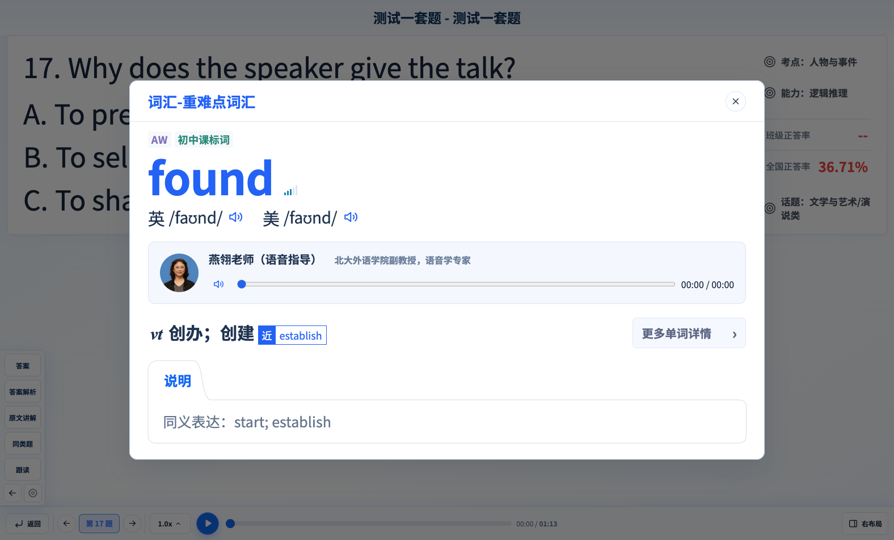

# 维克多教师端听力讲解 Demo

基于 **V1.2.159** 的独立网页发布副本，用于演示听力试题、课堂全屏讲解、词汇知识与音视频交互。

[在线演示](https://bulingbulinggogogo.github.io/victor-teacher-demo/) · [代码仓库](https://github.com/bulingbulinggogogo/victor-teacher-demo)



## 演示内容

- 试题与录音稿联动、答案解析、跟读和练习播放。
- 第一层词汇弹框、英美发音、语音指导及进度定位播放。
- 高考例句、语义网、辨析、更多单词详情及其他知识讲解。
- 明暗主题、字号调整及全屏讲解布局。

## 发布与更新约定

本仓库与本地 Demo 开发版本分开保存。后续修改先在本地完成，**只有项目负责人明确要求替换、更新或上传时，才同步本仓库**。没有监视本地文件的自动上传任务，也没有定时同步。只有经明确指令执行的推送才会触发 GitHub Pages 重新部署。

## 本地运行

在仓库根目录运行：

```bash
python3 -m http.server 19270 --bind 127.0.0.1
```

打开 `http://127.0.0.1:19270/`。请通过 HTTP 服务查看，不直接用文件协议打开。无需安装 Node.js 或启动后端。

## 文件结构

- `index.html`：网页入口。
- 根目录 CSS/JavaScript：V159 实际使用的界面、播放器与知识模块。
- `data/`：演示数据和音频映射。
- `assets/`：字体、图片、动画、音频、视频与附件。
- `.nojekyll`：GitHub Pages 原样发布静态文件。

发布副本去除了未引用的历史程序和设计核对文件；个人本地目录统一替换为匿名来源根，保留音频校验所需的相对来源关系。题目、单词及资源ID、媒体内容不因部署而重编或替换。

## 技术与访问边界

这是 HTML/CSS/JavaScript 静态演示。网页、数据和媒体随仓库一起托管，不依赖原开发电脑或本地预览服务。演示账号、班级操作及浏览器本地状态不构成真实业务后端或访问控制。

建议在桌面版 Chrome 中查看完整课堂讲解；浏览器可能要求点击后才允许播放音频。大量动画和视频的首次加载速度受网络影响。手机和触控设备没有在本次发布中完成全设备验收。

代码和教学素材仅供项目演示与评审。本仓库未添加开源许可证，不额外授予第三方素材的再分发权利。
